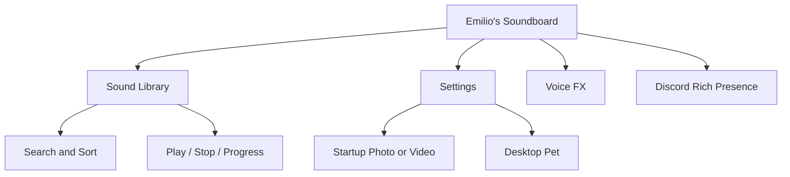
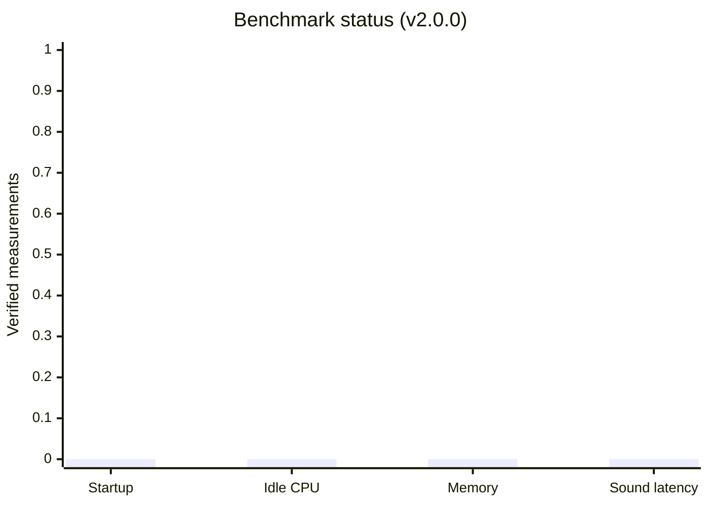

# Emilio's Soundboard

### Your sounds. Your setup. Your krissy.

A customizable Windows soundboard with a space-inspired UI, personal sound library, desktop pet and "Cool Mode".

  [Features](#features) /
  [Install](#get-started) /
  [Add sounds](#build-your-sound-library) /
  [Performance](#performance--benchmarking) /
  [Roadmap](#roadmap)

---

## Features

- **Instant soundboard:** Import your own audio and play it from searchable sound cards.
- **Playback control:** Stop the current sound and track playback progress.
- **Space-inspired UI:** Dark visual theme, animated background, search, and sorting.
- **Desktop pet:** Choose a custom image, resize it up to 300%, and let it wander, pause, look around, jump, and spin. The pet stays inside the app window.
- **Cool Mode:** Rainbow Road visuals, kart animation, and mode-specific music.
- **Startup media:** Choose a startup photo or video, with a popup-style presentation and fade transitions.
- **Voice FX:** Live microphone pitch effects. Device and runtime testing is still recommended.
- **Discord Rich Presence:** Show Soundboard activity in Discord when the Discord desktop app and integration are available.
- **Personal settings:** Keep settings and imported sound data separate from the app install folder.
- **Output device routing:** Send sounds to any playback device - pick a virtual cable to make them audible in Discord or OBS, globally or per sound.
- **Logging:** Rolling daily log with a diagnostics panel in settings (open the folder, copy the last 200 lines for a bug report).
- **Window material:** Optional Mica or Acrylic on the settings window (Windows 11 22H2 or newer).

> **Status note:** v2.0.0 is a source release. The project still needs a successful build and runtime test on Windows before its behaviour can be considered verified. Voice FX in particular should be tested with your actual microphone and output devices.

## Get started

### Quick install

1. Download and extract this repository (or download the source ZIP from Releases).
2. Install the [.NET 8 SDK](https://dotnet.microsoft.com/download/dotnet/8.0).
3. Double-click **`INSTALL-AND-CREATE-DESKTOP-SHORTCUT.bat`**.
4. When publishing completes, launch **Emilio's Soundboard** from your desktop shortcut.

If you want to build and launch without creating a shortcut, run **`BUILD-AND-RUN.bat`**. You can also open `EmiliosSoundboard.sln` in Visual Studio 2022.

### Create a portable release build

Run **`PUBLISH-PORTABLE.bat`** on Windows. It should create a self-contained Windows x64 output under `release/`. Test the generated executable before attaching it to a GitHub Release.

## Build your sound library

Click **`+ ADD SOUND`** in the app and import an audio file from your computer.

### Places to discover sounds

- **[MyInstants](https://www.myinstants.com/)** - browse meme sounds and sound buttons. Use the site's own download option when available.
- **[Pixabay Sound Effects](https://pixabay.com/sound-effects/)** - sound effects for projects.
- **[Mixkit Sound Effects](https://mixkit.co/free-sound-effects/)** - curated sound-effect library.
- **[Freesound](https://freesound.org/)** - community-uploaded audio with licenses that vary by sound.

**Copyright reminder:** a sound being playable or downloadable does not automatically mean you may redistribute it, include it in a public repository, or use it in monetized content. Check the individual sound's license and the source website's terms. Keep downloaded audio in your own local library unless you have permission to redistribute it. Don't upload other people's sound files to this repository without the required rights.

## How the app is organized

User settings and imported sound data are stored separately under `%LOCALAPPDATA%\EmiliosSoundboard`, so they aren't intended to live inside the source folder.

The code is split into three projects: `EmiliosSoundboard.Core` (library format and storage, plain .NET 8), `EmiliosSoundboard` (the WinForms app) and `EmiliosSoundboard.Tests` (xunit tests for the core). The core builds and its tests run on any OS; the UI is Windows-only.

## Performance & benchmarking

**No verified benchmark results are available yet.** I don't want to invent FPS, CPU, memory, or startup-time numbers. The graph below is a benchmark checklist - not fabricated measurements. Once measurements are collected on a real Windows machine, replace it with actual values and include the PC specs and test method.

The current code is written to avoid the usual fullscreen costs: the static backdrop (gradient, photo, drifting haze) is cached and re-rendered a few times a second instead of every frame, the card list is built once per frame instead of per paint, and the paint path no longer allocates GDI+ objects per frame. Those changes reduce work by construction; they have not been measured on a real machine.

| Metric to measure | Suggested test | Status |
|---|---|---|
| Cold startup time | Launch after the app has fully closed; record seconds to usable UI. | Not measured |
| Idle CPU | Observe process CPU after 60 seconds with no playback. | Not measured |
| Memory usage | Record working set after startup and after 10 minutes idle. | Not measured |
| Sound response | Measure click-to-audio onset with a repeatable test file. | Not measured |
| Voice FX stability | Test input/output device combinations and record errors or dropouts. | Needs Windows testing |

If you contribute measurements, please include Windows version, CPU, RAM, audio device, build configuration, and the exact steps used. That makes comparisons meaningful instead of guessing.

## Tech stack

- **C# / Windows Forms** - desktop UI
- **.NET 8** - application runtime and build target
- **NAudio** - audio playback and audio-device handling
- **Discord Rich Presence** - Discord activity integration
- **WPF media components** - used by the startup media implementation

## Roadmap

The full, prioritised list lives in **[ROADMAP.md](ROADMAP.md)** - P0 blockers (playback device routing, global hotkeys, installer), then soundboard core, library UX, and the unique stuff (shareable sound packs, an HTTP/Stream Deck trigger, a visualiser that reacts to audio).

Short version of what's done and what's next:

- [x] Searchable sound cards and sound importing
- [x] Stop-current-sound control
- [x] Custom startup media settings
- [x] Customizable desktop pet
- [x] Cool Mode
- [x] Discord Rich Presence configuration
- [x] Optional Mica / Acrylic window material (Windows 11 22H2+)
- [x] Sound output device selection, including per-sound overrides (needs Windows verification)
- [x] Rolling log file plus a diagnostics panel in settings
- [ ] Run the app on Windows and record what actually breaks
- [ ] Global hotkeys, always-on-top, tray icon, single instance
- [ ] Installer and signed release build
- [ ] Voice FX validated with multiple microphones and output devices
- [ ] Real performance and responsiveness benchmarks
- [ ] Shareable sound packs, HTTP/Stream Deck triggers, audio visualiser

## Contributing

Bug reports and suggestions are welcome. For a useful bug report, include:

1. Windows version and whether you used the installer or ran from source.
2. The exact steps that reproduce the problem.
3. The complete error output or a screenshot.
4. For audio issues, the selected microphone and output device (never include private account details).

Please keep all patch history in the single [`RELEASE-NOTES.md`](RELEASE-NOTES.md) file. Add a new dated section to that file for future updates instead of creating separate patch-note files.

## License & media

Choose and add a license file before accepting outside contributions or distributing the project publicly. Third-party logos, audio clips, images, and other media may have separate rights and are not automatically covered by the project's source-code license. Only redistribute assets you have the right to share.

---

**Made by Emilio · v2.0.0**

If something breaks, open an issue with the error log. If you improve it, add the details to `RELEASE-NOTES.md`.

Please do keep in mind, that this is still early in development!

---

